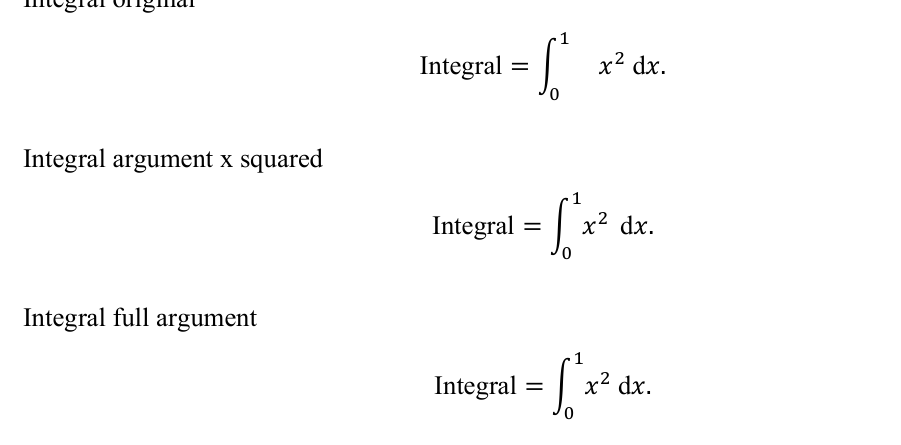
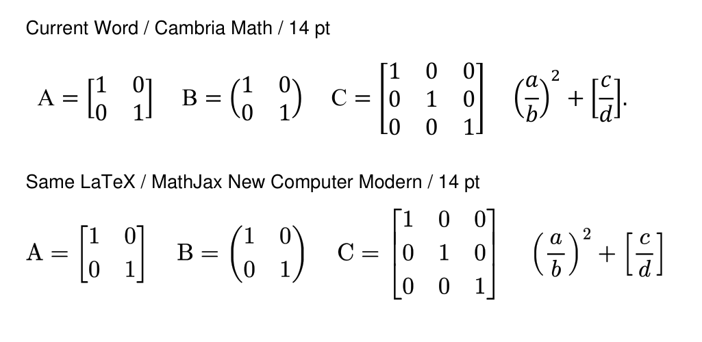

# Геометрия интеграла и растягиваемых скобок

Проверены выражения `Integral`, `Matrix` и `Fences` из `tests/fixtures/formulas/layout.md`.
Контроли экспортированы установленным Microsoft Word через штатный `accept:word`, с проверкой стабильного числа
страниц и завершения процессов. Сравнение выполнено в одном документе, при одинаковом размере формул 12 pt.

## Интеграл

В исходном OMML у `m:nary` оказался пустой аргумент `m:e`, а степень `x²` находилась следующим элементом.
Word оставлял место под пустой аргумент. После переноса следующего полного операнда в `m:e` промежуток уменьшился.
Перенос всего остатка выражения тоже убирал пустое место, но менял область аргумента; для исправления выбран перенос
только ближайшего операнда.

Расстояние от правого края текстового bounding box знака интеграла до левого края `x` в PDF:

- исходная структура: 17.94 pt;
- следующий операнд внутри аргумента: 4.98 pt;
- весь остаток внутри аргумента: 4.98 pt.

Это расстояния между текстовыми рамками PDF, а не между видимыми контурами глифов.

## Скобки

У матрицы и обеих дробей из `Fences` уже есть объекты `m:d`, правильные `begChr`/`endChr` и `grow=1`.
Круглые скобки охватывают дробь до применения внешней степени. В PDF математические символы отрисованы Cambria Math.
Сравнение стандартной формы скобок и явного `m:shp` со значением `match` не выявило заметного улучшения этих примеров.
Проверка подтвердила структурный охват содержимого, но не совпадение оформления с исходным LaTeX.
Первоначального сравнения с `match` оказалось недостаточно для вывода о визуальном качестве.
Это не проверка всех возможных вложенных формул и размеров матриц.

Устройство объектов описано в первичной документации Microsoft:
[аргумент и разделители](https://learn.microsoft.com/en-us/dotnet/api/documentformat.openxml.math.delimiter?view=openxml-3.0.1),
[расположение пределов оператора](https://learn.microsoft.com/en-us/dotnet/api/documentformat.openxml.math.limitlocation?view=openxml-3.0.1).

Структурная проверка `grow=1` не доказывает визуальное качество. Проверка 14 номеров формул в PDF также проверяет
положение номеров, а не интервал интеграла. Для этой ошибки нужен отдельный контроль аргумента и сравнение вывода Word.

## Исправление и повторная проверка

Обработка формул в TypeScript и Python заполняет пустой аргумент интеграла только ближайшим допустимым операндом.
Операторы, знаки пунктуации и уже заполненные аргументы сохраняются. Общий набор из 33 сценариев проверяет
оба пути преобразования и повторное применение без изменений; отдельные проверки преобразуют исходную формулу галереи.

После повторной сборки в принятом Word DOCX аргумент содержит `x²`, а дифференциал остаётся снаружи.
В итоговом PDF при размере формулы 14 pt расстояние между текстовыми рамками составляет 5.85 pt.
Проверка положения всех 14 номеров формул также проходит.

## Уточнение по визуальным образцам

После сравнения с предоставленными образцами проверены одинаковые единичные матрицы 2×2 и 3×3,
круглые скобки и дроби. Верхняя строка ниже получена через установленный Word, нижняя — через
MathJax 4.1.3 с его штатным шрифтом New Computer Modern. Номинальный размер — 14 pt в обоих случаях.
Это независимые экспорты одного LaTeX-выражения, а не обработка предоставленных снимков.

Разница визуально подтверждена: в варианте Word строки матриц плотнее, а контуры скобок отличаются от New Computer Modern.
В исходном MathML у матриц есть `rowspacing="4pt"`, но в полученном OMML параметры `rSp`/`rSpRule` отсутствуют.
Текущий перенос матриц сохраняет выравнивание столбцов, но не переносит заданные интервалы строк.
Это отдельная потеря параметров вёрстки, которую проверка `grow=1` не обнаруживает.

Восемь контролей Word включали явный Cambria Math, размер управляющего символа 15/16/18 pt,
а также `centered`/`match`. Эти изменения не дали требуемого запаса вокруг содержимого.
Дополнительные контроли показали, что прямое присваивание Word `rSp=4` или `8` при `rSpRule=3`
не эквивалентно зазору MathML в 4 или 8 pt: в проверенном документе расстояние между базовыми линиями
уменьшилось с 16.44 до 14.04 pt. Полуторный интервал Word заметно раздвигает строки, но не является
точным переносом исходного зазора.

Таким образом, наличие растягиваемых скобок не означает воспроизведение показанного пользователем набора.
Для точного переноса нужны согласованные метрики строк и математического шрифта; простое увеличение скобок
или запись числа `4` в OMML не решает эту задачу. Основной генератор по результатам этих контролей не менялся.
Скобки у дробей также остаются визуально отличающимися; исправление интеграла не закрывает этот вопрос.

Смысл расстояний в OMML описан в первичной документации Microsoft:
[`rSp`](https://learn.microsoft.com/en-us/dotnet/api/documentformat.openxml.math.rowspacing?view=openxml-3.0.1),
[`rSpRule`](https://learn.microsoft.com/en-us/dotnet/api/documentformat.openxml.math.rowspacingrule?view=openxml-3.0.1).
