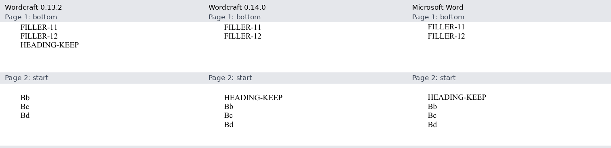

# Wordcraft 0.14.0: Word compatibility comparison

<!-- cspell:words PAGEREF MathLeading PDFium pypdf -->

## Version and comparison boundary

The opt-in renderer requires official CLI **0.14.0**, released on 1 November 2026,
commit
`5cd53f184aab11def13b7fced18727159b9bc96a`.
The [official release](https://github.com/storytold/wordcraft/releases/tag/v0.14.0)
and [tag comparison](https://github.com/storytold/wordcraft/compare/v0.13.2...v0.14.0)
are the upstream sources. The comparison contains 47 commits after 0.13.2.
Official archives are checked against SHA256SUMS before use; the previous 0.13.2
installation is preserved for rollback.

| Official archive                          | Verified SHA-256                                                   |
| ----------------------------------------- | ------------------------------------------------------------------ |
| wordcraft-0.14.0-linux-x86_64.tar.gz      | `3010da3d352d95256ec9a17a03966280a1d41ba09d0ebe569af23092d8b64987` |
| wordcraft-0.14.0-windows-x64-portable.zip | `c6eac6391d4be4dba7d039d4f600a9c840e74484ef7a5103acd4b1dcbe3bcfca` |

The audit uses the same frozen DOCX bytes for 0.13.2 and 0.14.0, separating
engine comparisons, native Windows output and native Word acceptance. Generator
base revision is `28762640463fb80604f53ed0538f6a43269196e4`, with new public
release controls. Legacy private inputs remain separate from current rebuilds.
Private sources, DOCX files, PDFs and extracted report text are not published.

## What upstream shipped

- [#4991](https://github.com/storytold/wordcraft/pull/4991): heading pagination
  handles the selected widow-controlled case with an exactly three-line following
  paragraph. This is not a general heading-to-table pagination fix.
- [#5097](https://github.com/storytold/wordcraft/pull/5097): hyperlinked TOC entries
  use bookmark-based `PAGEREF` fields with the hyperlink switch for page numbers,
  allowing Word to update them after headings move. Non-hyperlinked entries and
  suppressed page numbers retain their behavior. Generator field-span correctness
  is checked independently from this upstream change.
- [#5104](https://github.com/storytold/wordcraft/pull/5104): undefined paragraph
  styles, including Footer, resolve Normal paragraph and character properties.
  The original style identifier survives saving; defined styles and direct-format
  precedence retain their behavior. This does not establish identical footer layout
  for every document or style inheritance chain.
- [#4817](https://github.com/storytold/wordcraft/pull/4817): the actual print-job
  path removes link annotations. CLI PDF export retains links; a print-path fix
  must not be described as a change to the CLI export contract.

Versioned implementation evidence includes the [TOC builder](https://github.com/storytold/wordcraft/blob/5cd53f184aab11def13b7fced18727159b9bc96a/crates/engine/src/cmd/references/toc.rs#L510-L524),
[undefined-style tests](https://github.com/storytold/wordcraft/blob/5cd53f184aab11def13b7fced18727159b9bc96a/crates/docx/tests/it/undefined_style.rs#L11-L70)
and [style resolution](https://github.com/storytold/wordcraft/blob/5cd53f184aab11def13b7fced18727159b9bc96a/crates/doc/src/resolve.rs#L407-L429).

The comparison does not change math/matrix, table or font implementations.
[The MathLeading proposal #2674](https://github.com/storytold/wordcraft/pull/2674)
remains open and outside the release. No general equation-spacing, matrix fidelity,
table or font-selection improvement is attributed to this upgrade.

## Frozen-corpus results

The full corpus contains nineteen inputs and 248 pages in each engine version.
Only two PDFs change between 0.13.2 and 0.14.0: the widow-enabled three-line control
(2,202 changed pixels across two pages) and the undefined-style control (7,651
across three pages). The other seventeen PDFs are byte-identical, including the
two negative widow controls, large reports, formulas, matrices and spanning cells.
All nineteen inputs retain their page counts and page geometry between versions.

Seventeen inputs have fresh accepted native Word receipts, stable saved/reopened
pagination and verified process cleanup: 157 Word pages versus 156 engine pages.
The two legacy private inputs participate only in engine/platform comparisons.
The coursework remains 69 Word pages versus 68 in both engine versions; the
research report remains 26 pages in all three workflows.

| Case                           | Word pages | Engine pages, both versions | Mean changed pixels from Word, 0.13.2 | Mean changed pixels from Word, 0.14.0 |
| ------------------------------ | ---------: | --------------------------: | ------------------------------------: | ------------------------------------: |
| Three lines, widow control on  |          2 |                           2 |                               1.2270% |                               0.7252% |
| Three lines, widow control off |          2 |                           2 |                               0.6906% |                               0.6906% |
| One fewer filler paragraph     |          1 |                           1 |                               1.3336% |                               1.3336% |
| Undefined-style controls       |          3 |                           3 |                               0.3809% |                               0.1781% |
| Rebuilt coursework             |         69 |                          68 |                              13.1904% |                              13.1904% |
| Rebuilt NIR                    |         26 |                          26 |                               6.3043% |                               6.3043% |
| Default preset                 |          8 |                           8 |                               2.2214% |                               2.2214% |
| Samara preset                  |          8 |                           8 |                               2.2365% |                               2.2365% |
| Formula layout                 |          4 |                           4 |                               4.0742% |                               4.0742% |
| Math and appendix              |          5 |                           5 |                               0.7220% |                               0.7220% |
| Matrix controls                |          4 |                           4 |                               2.7823% |                               2.7823% |
| Spanning-cell controls         |          1 |                           1 |                               3.6498% |                               3.6498% |
| Previous release controls      |          4 |                           4 |                               3.6421% |                               3.6421% |
| Three sections                 |          7 |                           7 |                               5.3956% |                               5.3956% |
| Expand manual break            |          1 |                           1 |                               3.3593% |                               3.3593% |
| Suppress manual expansion      |          1 |                           1 |                               3.3538% |                               3.3538% |
| 90-row table                   |         11 |                          11 |                               3.1073% |                               3.1073% |

Raster comparison improves on the two release controls; the other fifteen accepted
Word comparisons remain unchanged between engine versions. These fractions include
white page area and do not measure the percentage of correct formatting. The
unmatched coursework page contributes zero to its mean, so the remaining page-count
difference must be read alongside the raster figure. Matrix and formula output
remaining unchanged does not remove their existing differences from Word.

The base revision already includes generator fixes for n-ary formula conversion
and source preflight from PRs #90 and #91. Those changes are shared by both engine
versions in this comparison. Differences from earlier audit corpora must not be
attributed to the Wordcraft upgrade alone.

### Table and image preservation controls

Fresh checks agree across Word, 0.13.2, 0.14.0 Linux/WSL and native Windows: the
90-row table retains rows 1–28 on page 6, 29–58 on page 7, 59–88 on page 8 and
89–90 on page 9, with three continuation captions. The three-section control
retains forty rows, two continuation captions and page labels `1, 2, i, ii, 1, 2, 3`.
These checks establish the selected row boundaries and labels, not complete visual parity.

The four large inputs preserve all 38 encoded image objects between engine versions.
No recorded object has an alpha mask, so this comparison does not exercise alpha-mask
preservation or establish visual fidelity from resource presence alone.

## Platform and font result

All nineteen final 0.14.0 PDFs are byte-identical on Linux/WSL and native Windows:
248 pages per set. Independent normalized-text, geometry and raster comparisons
record no differences. This establishes platform agreement for this corpus,
including the two separately labelled legacy inputs, without granting them fresh
Word acceptance or establishing Word layout parity.

Linux explicitly loads local licensed font files, with matching file hashes between
0.13.2 and 0.14.0 for every case. The per-case set contains 4, 5 or 9 files.
Windows already has the required families in its native catalog and does not load
explicit files. The font files selected from that catalog are not independently
hashed. Identical output does not fill that font-provenance gap.

## Measured release controls

### Heading and three-line paragraph

The public fixture uses Times New Roman 14-point text, exact 16-point line spacing,
and a 240-point body area. Twelve filler paragraphs place a keep-with-next heading
and a following three-line paragraph at the measured boundary. The boundary was
calibrated on actual engine output rather than inferred from DOCX dimensions.
The table lists one-based physical pages for the heading and each following line.

| Control                             | 0.13.2 pages  | 0.14.0 Linux/WSL pages | 0.14.0 native Windows pages | Word pages    |
| ----------------------------------- | ------------- | ---------------------- | --------------------------- | ------------- |
| Three lines, widow control on       | 1 / 2 / 2 / 2 | 2 / 2 / 2 / 2          | 2 / 2 / 2 / 2               | 2 / 2 / 2 / 2 |
| Three lines, widow control off      | 1 / 1 / 1 / 2 | 1 / 1 / 1 / 2          | 1 / 1 / 1 / 2               | 1 / 1 / 1 / 2 |
| One fewer filler paragraph, all fit | 1 / 1 / 1 / 1 | 1 / 1 / 1 / 1          | 1 / 1 / 1 / 1               | 1 / 1 / 1 / 1 |

The panel shows the public synthetic widow-enabled control at the page boundary:
0.13.2 leaves the heading on page 1; 0.14.0 and Word keep it with the paragraph on page 2.

The widow-enabled case now keeps the heading with all three lines, matching Word
on this input. The two negative controls retain their page assignments. This
measurement covers the exactly-three-line case and does not establish heading-to-table
pagination fidelity or general widow/orphan parity.

### Undefined paragraph style

A separate control uses an undefined Footer style in both the document body and
footer story. Its Normal style supplies 13-point text. Defined Footer9 and direct
16-point formatting provide negative controls. Independent PDF font measurements
agree between the two 0.14.0 platforms.

| Control, body and footer story    | 0.13.2 font, pt | 0.14.0 font, pt | Word font, pt |
| --------------------------------- | --------------: | --------------: | ------------: |
| Undefined Footer, Normal is 13 pt |           12.00 |           13.00 |         12.96 |
| Defined Footer9                   |            9.00 |            9.00 |          9.00 |
| Direct 16 pt                      |           16.00 |           16.00 |         15.96 |

The fallback moves toward Word's measured Normal size while the defined-style
and direct-format controls remain unchanged. These sizes are PDF measurements,
not a claim that every glyph or footer position matches Word.

### TOC/PAGEREF and retained field preparation

A direct official-engine TOC-generation probe creates no PAGEREF fields in 0.13.2
and two in 0.14.0. The new instructions target existing bookmarks
`_Toc000000001` and `_Toc000000002`, each with the hyperlink switch. Cached entries
remain Alpha on page 2 and Bravo on page 3 in both versions. Saving/reopening and
another field update preserve the new fields and their targets.

This probe establishes generated field structure and persistence. It does not
establish an isolated native Word PAGEREF-only update after moving headings:
the supported Word launcher updates the whole TOC. That user-visible outcome
remains outside this isolated probe.

The existing raw TOC boundary probe still fails the numbered-entry-inside-field
check in both versions. Prepared staging copies pass the strict boundary checks
and preserve the source in both versions. The existing preparation workaround
therefore remains necessary; new PAGEREF support does not remove it.

## Measurement method and limits

Each engine receives identical DOCX bytes. Independent PDF checks record page
counts, geometry, normalized text, resources and raster differences separately.
Pages are paired by ordinal without realigning reflow. PDFium/Pillow raster
comparison uses 96 DPI and channel tolerance 16; pypdf supplies independent PDF
inspection. Changed-pixel fractions include white page area and are not percentages
of correct formatting. Page totals alone do not establish layout parity.

Native Word runs only through `npm run accept:word -- <docx> --background-only`,
with stable saved/reopened pagination and exact owned-process cleanup. No Computer
Use or desktop input is used. Engine rendering of a legacy DOCX does not grant it
a fresh STO acceptance. Comparisons with Word include the generator's field and
table preparation workflow.

Native macOS, ARM/RISC-V and a physical Linux host are outside this audit.
Agreement between Linux/WSL and native Windows output establishes only the
measured platform agreement. Windows bridge timings are not native performance
benchmarks. Licensed fonts remain local.

Historical measurements remain in the [0.13.2 audit](2026-11-01-wordcraft-0132.md).
Cross-audit differences may include generator/input changes and must not be
interpreted as engine-only improvements. Practical checks remain in the
[compatibility matrix](../wordcraft-compatibility.md).
