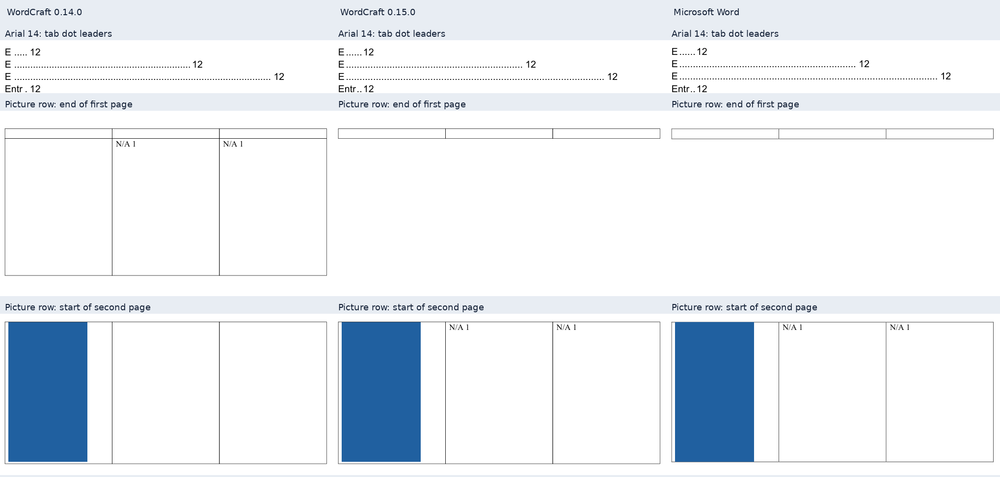

# Wordcraft 0.15.0: Word compatibility comparison

<!-- cspell:words altChunk MHT MathLeading PDFium pypdf PAGEREF -->

## Known release regression

The oversized-picture control regresses from four pages in 0.14.0 to five in
0.15.0 on both Linux/WSL and native Windows; accepted Word output has three.
The control contains a 700-pt image against a 648-pt body area and sixty text
paragraphs. Independent PDF inspection and the accepted Word receipt establish
these counts. This deliberately oversized input does not fit a page, but its
additional engine page is still an observed release regression. Keep images
inside table cells within the available body height; resize the image and
rebuild before relying on the PDF. No engine fork or general oversized-row fix
is introduced here.

## Version and comparison boundary

The opt-in renderer requires official CLI **0.15.0**, released on 3 November 2026
at 00:53:40 UTC, commit `b47079fc791595fd84bb499d64dcd3f0624ef35a`.
The [official release](https://github.com/storytold/wordcraft/releases/tag/v0.15.0)
and [tag comparison](https://github.com/storytold/wordcraft/compare/v0.14.0...v0.15.0)
are the upstream sources. The comparison contains 81 commits and 214 changed paths.
This upgrade uses the official engine without a local fork. Official archives are
verified against SHA256SUMS and the release API asset hashes.

| Official archive                          | Verified SHA-256                                                   |
| ----------------------------------------- | ------------------------------------------------------------------ |
| wordcraft-0.15.0-linux-x86_64.tar.gz      | `baacf18158124abc3d45dc4485bfc77a5d717f80ac50b80693b6501c26698e5d` |
| wordcraft-0.15.0-windows-x64-portable.zip | `2d16f589fe4f8448cd6a8124ef92cfa61e075b9c02c401e6c1f67172aa9495a8` |

The comparison gives 0.14.0 and 0.15.0 identical frozen DOCX bytes. Engine-version
comparisons, native Windows output and native Word acceptance are separate checks.
The frozen generator base is `54322cbc405daf6dac20fd2d7abf01ba9934dbb9`.
The corpus contains the nineteen previous inputs and eleven new public controls:
five split-row vertical-alignment controls, four picture-row controls and two
leader controls using Times New Roman 12 pt and Arial 14 pt. The public fixture
is an intentional Times New Roman adaptation, not an exact copy of upstream's
Source Sans 3 fixture. Private sources, DOCX files, PDFs and extracted report text
are not published.
Historical results remain in the [0.14.0 audit](2026-11-02-wordcraft-0140.md);
changes between audit corpora must not be attributed to the engine upgrade alone.

## What upstream shipped

- [#5144](https://github.com/storytold/wordcraft/pull/5144): tab dot leaders use a
  600-DPI pixel grid and revised pitch. This targets the leader pattern, rather
  than establishing complete TOC layout parity.
- [#5145](https://github.com/storytold/wordcraft/pull/5145): center- and
  bottom-aligned cell content uses the first page fragment of a split table row.
  It does not establish vertical-alignment parity for every merged or nested cell.
- [#5161](https://github.com/storytold/wordcraft/pull/5161): a picture-containing
  row moves to the next page when the current page is occupied and splitting
  would leave an empty first cell. A row taller than a page can still split.
- [#2485](https://github.com/storytold/wordcraft/pull/2485): header objects with
  `relativeFrom=Margin` use the rendered body top as their reference boundary.
  Page, TopMargin, InsideMargin and footer anchors retain their behavior. This
  does not move the body boundary to the header margin or establish parity for
  every header story.
- [#5221](https://github.com/storytold/wordcraft/pull/5221): DOCX import handles
  tables inside `AlternateContent`. This does not establish coverage of every
  alternate-content branch or drawing type.
- [#1104](https://github.com/storytold/wordcraft/pull/1104): the engine imports
  HTML, MHT, RTF and text `altChunk` content. This is an engine import capability;
  the generator does not gain an HTML/RTF input mode or emit `altChunk` parts.
- [#5167](https://github.com/storytold/wordcraft/pull/5167) changes same-font
  tests only. It is not evidence of a production font-selection fix.

The comparison has no math/matrix implementation changes. No general equation
spacing or matrix fidelity improvement is attributed to this upgrade.
The MathLeading proposal [#2674](https://github.com/storytold/wordcraft/pull/2674)
is not established as shipped by this release.

## TOC/PAGEREF and retained field preparation

The direct official-engine TOC probe creates two bookmark-targeting PAGEREF
fields in both 0.14.0 and 0.15.0. Targets `_Toc000000001` and `_Toc000000002`
exist; both instructions retain the hyperlink switch. Saving/reopening and
another field update preserve the fields and targets. Cached entries remain
Alpha on page 2 and Bravo on page 3 in both versions.

The raw TOC probe still fails the numbered-entry-inside-field check in both
versions. Prepared staging copies pass the strict field-span check and preserve
the source in both versions. The existing preparation workaround remains
necessary. This checks field structure and persistence, not an isolated native
Word PAGEREF-only refresh after a heading moves.

## Measured tab-leader controls

Independent PDF glyph positions show a closer dot pattern on both public leader
controls. The table reports median pitch in points, not raster percentages.

| Font and size          | 0.14.0 pitch, pt | 0.15.0 pitch, pt | Word pitch, pt |
| ---------------------- | ---------------: | ---------------: | -------------: |
| Times New Roman, 12 pt |          3.00000 |          3.00000 |        3.00000 |
| Arial, 14 pt           |          3.89200 |  3.96234–3.96235 |        3.96002 |

Arial's new pitch is approximately 3.96 pt and closer to Word, not exactly equal.
In Times New Roman the median pitch stays at 3 pt; the grid start and dot counts
change. The second measured row changes from 88 to 89 dots, matching Word's 89;
the fourth changes from 5 to 6, matching Word's 6. The fourth row starts at 96 pt
in 0.14.0, 93 pt in 0.15.0 and 93.024 pt in Word. Small horizontal-origin offsets
and vertical-position differences remain, so this is not complete leader parity.
The new positions match between Linux/WSL and native Windows on both controls.

The frozen formula-layout and matrix-control PDFs are byte-identical between
0.14.0 and 0.15.0. Their existing differences from Word remain; unchanged output
does not establish a mathematical layout improvement.

## Measured picture-row controls

In the public control with 214 pt of available room, 0.14.0 leaves two `N/A 1`
cell texts on page 1 while the image alone moves to page 2. In 0.15.0 on both
Linux/WSL and native Windows, the image and both texts move together to page 2,
matching Word's page assignment. No image or `N/A 1` text remains on page 1.
The 260-pt negative control fits on one page in all four workflows. The oversized
picture control regresses as described above; the negative controls must not be
summarized as all unchanged. Text baseline
positions still differ from Word; matching page assignment does not establish
complete cell layout parity.

The panel uses actual PDF crops from the public synthetic controls. The first row
shows the Arial leader pattern; the lower rows show the end of page 1 and start
of page 2 for the 214-pt picture-row control.

## Table and image preservation controls

Fresh checks agree across Word, 0.14.0, 0.15.0 Linux/WSL and native Windows:
the 90-row table retains rows 1–28 on physical page 6, 29–58 on page 7, 59–88 on
page 8 and 89–90 on page 9, with three continuation captions. The three-section
control preserves forty rows, two continuation captions and page labels
`1, 2, i, ii, 1, 2, 3`. These checks establish the selected row boundaries and
labels, not complete visual parity.

The four large inputs retain all 38 encoded image objects between engine
versions, with matching recorded properties and encoded hashes. No recorded
object has an alpha mask, so this does not exercise alpha-mask preservation.
Resource presence and identical encoded bytes do not by themselves establish
visual fidelity.

## Frozen-corpus results

The final thirty-input corpus has 269 pages in 0.14.0 and 270 in 0.15.0.
Twelve PDFs are byte-identical between versions; eighteen change. The additional
page belongs to the oversized-picture regression described above. All thirty
0.15.0 PDFs are byte-identical between Linux/WSL and native Windows, totaling
270 pages per platform. Independent text, geometry and raster checks agree.
This establishes platform agreement for these inputs, not Word layout parity.

Twenty-eight inputs have fresh accepted native Word receipts, stable
saved/reopened pagination and verified process cleanup: 177 Word pages versus
177 in 0.14.0 and 178 in 0.15.0. The two legacy inputs participate only in
engine/platform comparisons. The coursework remains 69 Word pages versus 68
in both engine versions; the research report remains 26 in all three workflows.

| Case                      | Word pages | 0.14.0 pages | 0.15.0 pages | Mean changed pixels from Word, 0.14.0 | Mean changed pixels from Word, 0.15.0 |
| ------------------------- | ---------: | -----------: | -----------: | ------------------------------------: | ------------------------------------: |
| widow-three-on            |          2 |            2 |            2 |                               0.7252% |                               0.7252% |
| widow-three-off           |          2 |            2 |            2 |                               0.6906% |                               0.6906% |
| widow-fit                 |          1 |            1 |            1 |                               1.3336% |                               1.3336% |
| undefined-style           |          3 |            3 |            3 |                               0.1781% |                               0.1781% |
| Rebuilt coursework        |         69 |           68 |           68 |                              13.1904% |                              13.1649% |
| Rebuilt research report   |         26 |           26 |           26 |                               6.3043% |                               6.2744% |
| Default preset            |          8 |            8 |            8 |                               2.2214% |                               2.1531% |
| Samara preset             |          8 |            8 |            8 |                               2.2365% |                               2.1682% |
| formula-layout            |          4 |            4 |            4 |                               4.0742% |                               4.0742% |
| leaders-arial             |          1 |            1 |            1 |                               1.5388% |                               1.4947% |
| leaders-tnr               |          1 |            1 |            1 |                               1.4736% |                               1.4778% |
| Math and appendix         |          5 |            5 |            5 |                               0.7220% |                               0.6824% |
| matrix                    |          4 |            4 |            4 |                               2.7823% |                               2.7823% |
| merged-span               |          1 |            1 |            1 |                               3.6498% |                               3.6498% |
| picture-room214           |          2 |            2 |            2 |                               0.6224% |                               0.3841% |
| picture-room260           |          1 |            1 |            1 |                               0.7533% |                               0.7533% |
| picture-split-text        |          2 |            2 |            2 |                               0.8270% |                               0.8270% |
| picture-tall-picture      |          3 |            4 |            5 |                              10.5517% |                               3.9866% |
| Previous release controls |          4 |            4 |            4 |                               3.6421% |                               3.6426% |
| sections                  |          7 |            7 |            7 |                               5.3956% |                               5.3956% |
| shift-expand              |          1 |            1 |            1 |                               3.3593% |                               3.3593% |
| shift-natural             |          1 |            1 |            1 |                               3.3538% |                               3.3538% |
| split-bottom-after6       |          2 |            2 |            2 |                               3.2941% |                               3.1825% |
| split-bottom1             |          2 |            2 |            2 |                               3.2941% |                               3.1825% |
| split-center1             |          2 |            2 |            2 |                               3.2889% |                               3.1825% |
| split-center3             |          2 |            2 |            2 |                               3.4970% |                               3.1825% |
| split-long-center         |          2 |            2 |            2 |                               4.9060% |                               3.4712% |
| 90-row table              |         11 |           11 |           11 |                               3.1073% |                               3.0587% |

These page-wide fractions include white space and are neither percentages of
correct formatting nor an overall quality score. The Times New Roman leader
control rises slightly from 1.4736% to 1.4778%; the previous release controls rise
from 3.6421% to 3.6426%. A local improvement in measured dot counts does not
require the whole-page fraction to improve. The oversized-picture fraction falls
from 10.5517% to 3.9866% even though pagination regresses from four to five pages.
Unmatched pages contribute zero to the mean, so that fall must not be presented
as a quality improvement. The coursework's unmatched page likewise requires its
page-count difference to be read alongside the raster result.

Changes in the math-and-appendix document do not establish a formula-layout
change: TOC leaders are part of that input. The dedicated formula-layout and
matrix PDFs remain byte-identical between engine versions.

## Measured split-row vertical alignment

Counts below refer to `LEFT` paragraphs on physical pages 1 and 2. The right cell
retains fifteen paragraphs on each page. Both 0.15.0 platforms agree with the
listed Word page assignments; exact cell geometry still differs.

| Control                                  | 0.14.0, pages 1 / 2 | 0.15.0, pages 1 / 2 | Word, pages 1 / 2 |
| ---------------------------------------- | ------------------- | ------------------- | ----------------- |
| Center, one paragraph                    | 1 / 0               | 1 / 0               | 1 / 0             |
| Center, three paragraphs                 | 2 / 1               | 3 / 0               | 3 / 0             |
| Bottom, one paragraph                    | 0 / 1               | 1 / 0               | 1 / 0             |
| Bottom, one paragraph with after-spacing | 0 / 1               | 1 / 0               | 1 / 0             |
| Center, twenty-five paragraphs           | 13 / 12             | 15 / 10             | 15 / 10           |

The split-text picture control retains two pages and the same raster result
against Word. The fit-on-page picture control also remains unchanged. These
negative results are separate from the oversized-picture regression.

## Platform and font boundary

Linux loads local licensed font files; Windows uses its native font catalog.
Catalog availability does not identify or hash every selected native font file.
Identical platform output does not fill that font-provenance gap. Native Windows
cleanup verification covers 749 invocations and 1,498 owned process identities,
all absent afterward; none required termination, and staging was removed.
Native macOS has not been rendered in this audit.

## Measurement method and limits

Each engine receives identical DOCX bytes. Independent PDF checks distinguish
page counts, geometry, normalized text, resources and raster differences. Pages
are paired by ordinal without realigning reflow. PDFium/Pillow raster comparison
uses 96 DPI and channel tolerance 16; pypdf supplies independent PDF inspection.
Changed-pixel fractions include white page area and are not percentages of correct
formatting. Page totals alone do not establish layout parity.

Native Word runs only through `npm run accept:word -- <docx> --background-only`.
A fresh accepted receipt requires stable saved/reopened pagination and verified
cleanup of the exact owned processes. Engine rendering of a legacy DOCX does not
grant it fresh Word acceptance. Comparisons with Word include the generator's
field and table preparation workflow.

Native macOS, ARM/RISC-V and a physical Linux host are outside this audit.
Upstream CI does not establish native Mac execution or Word layout parity.
Linux/WSL and native Windows agreement, when measured, covers only the selected
corpus. Windows bridge timings are not native performance benchmarks. Licensed
fonts remain local; catalog availability and font-file provenance are separate
checks.

Practical checks remain in the [compatibility matrix](../wordcraft-compatibility.md).
