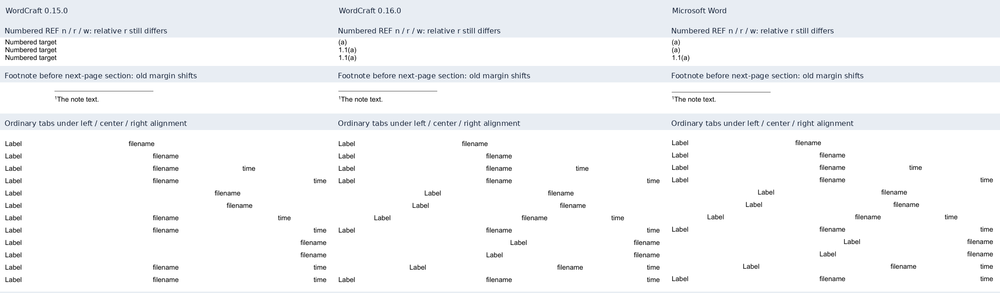

# Wordcraft 0.16.0: Word compatibility comparison

<!-- cspell:words STYLEREF PAGEREF NUMWORDS MATH PDFium pypdf noEndnote -->

## Version and comparison boundary

The opt-in renderer requires official stable CLI **0.16.0**, released on
6 November 2026 at 20:22:22 UTC, commit
`02a802cbafe45b5c8fecc00490c8f6b78c5ba251`. The previous supported version is
0.15.0, commit `b47079fc791595fd84bb499d64dcd3f0624ef35a`.
This upgrade uses the official engine without a local fork.

The [0.16.0 release](https://github.com/storytold/wordcraft/releases/tag/v0.16.0)
notes cover only the transition from 0.15.2. The complete comparison from the
project's previous baseline includes all three intervals:

| Official comparison                                                                 | Commits | Scope                                       |
| ----------------------------------------------------------------------------------- | ------: | ------------------------------------------- |
| [0.15.0 → 0.15.1](https://github.com/storytold/wordcraft/compare/v0.15.0...v0.15.1) |      53 | First intervening release                   |
| [0.15.1 → 0.15.2](https://github.com/storytold/wordcraft/compare/v0.15.1...v0.15.2) |       5 | Includes a large squashed source snapshot   |
| [0.15.2 → 0.16.0](https://github.com/storytold/wordcraft/compare/v0.15.2...v0.16.0) |     253 | Remaining changes through the stable target |

The full gap contains 311 commits. Commit titles alone do not classify the
intermediate release: [the 0.15.2 release commit](https://github.com/storytold/wordcraft/commit/74d3701c747c60568c97f1518213b66a70c48454)
contains a large squashed source snapshot. It must not be treated as packaging-only.
The sections below distinguish changes in
that source range from measured behavior on the generator's DOCX files.
Historical results remain in the [0.15.0 audit](2026-11-03-wordcraft-0150.md).
The current frozen generator base is `0b67a3106cacdb9b57cbae210c0db1a104a3821e`.
Official archives were checked against the release checksums and asset hashes:

| Official archive                          | Verified SHA-256                                                   |
| ----------------------------------------- | ------------------------------------------------------------------ |
| wordcraft-0.16.0-linux-x86_64.tar.gz      | `325b97f15bbf532628a3176a9c17148a7175f3e4f19b9313de323ab513609752` |
| wordcraft-0.16.0-windows-x64-portable.zip | `aab5bfc4b5ce63c1bb1036ea2ab68aa1dbb300d8936de948c29739b15b3118e3` |

## Fields and retained TOC preparation

Upstream [#5162](https://github.com/storytold/wordcraft/pull/5162) automatically
refreshes unlocked body SEQ, STYLEREF and plain REF fields on an output copy.
It preserves cached values for numeric REF switches `\r`, `\n`, `\w`, position
switch `\p`, and bookmarks spanning multiple paragraphs. The editor document
is unchanged by this output preparation. This path already appears in the
[0.15.2 snapshot](https://github.com/storytold/wordcraft/blob/edfea68101220c9bdc4b2b0ccf4acd9612bedb6e/crates/engine/src/cmd/references/fields.rs#L274);
its mention in the 0.16.0 notes does not establish first introduction there. See the
[pinned field implementation](https://github.com/storytold/wordcraft/blob/02a802cbafe45b5c8fecc00490c8f6b78c5ba251/crates/engine/src/cmd/references/fields.rs#L183-L225).

The CLI's `--update-fields` explicitly invokes `references.updateFields({})`;
its default scope is the body, rather than every document story. The generator
continues to update fields explicitly in its staged copy. Automatic refresh on
export does not establish that headers, footers and all complex switches are
covered. See the
[pinned CLI path](https://github.com/storytold/wordcraft/blob/02a802cbafe45b5c8fecc00490c8f6b78c5ba251/apps/wordcraft-cli/src/main.rs#L430-L455).

Upstream [#4609](https://github.com/storytold/wordcraft/pull/4609) adds paragraph
number REF handling. Its tests distinguish full-context `\w`, current-level
`\n` and context-relative `\r`; ambiguous or unsupported cases retain their
cached result. The
[pinned tests](https://github.com/storytold/wordcraft/blob/02a802cbafe45b5c8fecc00490c8f6b78c5ba251/crates/engine/tests/it/ref_paragraph_numbers.rs#L108-L185)
are narrower evidence than complete Word field compatibility.

The fresh direct TOC probe retains two bookmark-targeting PAGEREF fields in
both versions. The targets exist and save/reopen/update preserves the fields.
The raw numbered-entry-inside-field check still fails, while prepared staging
copies pass and preserve the source. The existing TOC workaround remains.

### Measured field controls

Without explicit field update, both versions save the original field caches and
preserve the source bytes. Their exported PDFs differ: 0.15.0 keeps SEQ `7`,
`stale style` and `stale text`, while 0.16.0 exports SEQ `1`, `Chapter One` and
`Target words`. Both raw exports retain the three stale numeric REF results,
NUMWORDS `999` and locked SEQ `9`. This confirms the output-only refresh boundary.

With explicit update, used by our adapter, both versions produce SEQ `1`,
STYLEREF `Chapter One`, plain REF `Target words`, NUMWORDS `28` and locked SEQ `9`.
The numeric REF control distinguishes improvement from the remaining discrepancy:

| Switch | 0.15.0 result     | 0.16.0 result | Word result |
| ------ | ----------------- | ------------- | ----------- |
| `\n`   | `Numbered target` | `(a)`         | `(a)`       |
| `\r`   | `Numbered target` | `1.1(a)`      | `(a)`       |
| `\w`   | `Numbered target` | `1.1(a)`      | `1.1(a)`    |

The `\n` and `\w` results now match Word on this control. Relative `\r` still
returns the full context instead of Word's `(a)`; complete numeric REF parity
is not established. NUMWORDS `28` and locked SEQ `9` also match Word. The final
fixture uses a custom non-bold `FixtureHeading` style for STYLEREF; it is the
same frozen input for raw probes, paired exports and Word acceptance.

## Sections, paragraph layout and images

- [#5311](https://github.com/storytold/wordcraft/pull/5311) preserves section
  metadata including paper trays, `noEndnote`, footnote columns and chapter-number
  settings. Invalid values are omitted. This is an import/save contract, as shown
  by the [pinned tests](https://github.com/storytold/wordcraft/blob/02a802cbafe45b5c8fecc00490c8f6b78c5ba251/crates/docx/tests/it/section_metadata_preservation.rs#L26-L65).
- [#5291](https://github.com/storytold/wordcraft/pull/5291) keeps the prior section's
  margins when flushing its page before next/even/odd section starts. The
  [pinned layout control](https://github.com/storytold/wordcraft/blob/02a802cbafe45b5c8fecc00490c8f6b78c5ba251/crates/layout/src/tests.rs#L3150-L3187)
  changes the following section's margin from 72 to 144 pt to expose the boundary.
- [#5715](https://github.com/storytold/wordcraft/pull/5715) moves ordinary tabs with
  paragraph alignment. Lists, RTL, positional tabs and display math are excluded
  from this path. See the [pinned condition](https://github.com/storytold/wordcraft/blob/02a802cbafe45b5c8fecc00490c8f6b78c5ba251/crates/layout/src/para/lines.rs#L550-L566).
- [#5755](https://github.com/storytold/wordcraft/pull/5755) keeps leading spaces
  fixed in justified/distributed lines; the
  [pinned implementation](https://github.com/storytold/wordcraft/blob/02a802cbafe45b5c8fecc00490c8f6b78c5ba251/crates/layout/src/para/lines.rs#L726-L772)
  does not establish every justification or special-space case.
- [#5763](https://github.com/storytold/wordcraft/pull/5763) removes extra descent
  from picture-only lines. A 30-pt picture with single spacing has a 30-pt line;
  mixed text still needs descent and multiple spacing adds a font-derived share.
  See the [pinned controls](https://github.com/storytold/wordcraft/blob/02a802cbafe45b5c8fecc00490c8f6b78c5ba251/crates/layout/src/tests.rs#L13682-L13774).
- [#4545](https://github.com/storytold/wordcraft/pull/4545) clamps eligible floating
  cell objects to outer cell edges. Offset, `layoutInCell`, wrapping and turned-cell
  conditions limit the fix. [#5775](https://github.com/storytold/wordcraft/pull/5775)
  follows a later-page paragraph anchor to its actual page;
  [#5786](https://github.com/storytold/wordcraft/pull/5786) follows text across a page
  break while allowing cover floats anchored only to invisible markers to stay.
  These changes do not establish complete floating-image or image-effect parity.

Upstream [#5498](https://github.com/storytold/wordcraft/pull/5498) preserves
paragraph `w:textAlignment` values through DOCX save. The property is vertical
alignment (`auto`, `top`, `center`, `baseline`, `bottom`), separate from horizontal
paragraph justification. This is round-trip support only: layout does not yet
consume the property. See the
[pinned tests](https://github.com/storytold/wordcraft/blob/02a802cbafe45b5c8fecc00490c8f6b78c5ba251/crates/docx/tests/it/text_alignment.rs#L31-L64).

The fresh oversized-picture control remains five pages in both 0.15.0 and
0.16.0 versus three in accepted Word output. Its picture is 700 pt high against
a 648-pt body. The prior regression is not fixed by this upgrade. An upstream
oversized-row test requires at least three nonempty fragments, rather than
exactly three pages; that assertion does not contradict the measured result.
Keep table-cell images within available body height and rebuild before relying
on the PDF.

## Fonts, math and input limits

Upstream [#5733](https://github.com/storytold/wordcraft/pull/5733) borrows Windows
counterpart line metrics only for the exact Times and Courier families. Times
New Roman and Courier New are unaffected by that mapping. See the
[pinned font code](https://github.com/storytold/wordcraft/blob/02a802cbafe45b5c8fecc00490c8f6b78c5ba251/crates/fonts/src/word.rs#L466-L510).
This is not evidence of a change to this audit's Times New Roman controls.

Upstream [#5683](https://github.com/storytold/wordcraft/pull/5683) shares MATH
records during construction; this is a memory/performance change, not a new
formula-layout algorithm. [#4000](https://github.com/storytold/wordcraft/pull/4000)
caps the DOCX matrix writer at 1,000 rows and 64 columns, dropping excess
content; parsing, JSON and editing remain uncapped. See the
[pinned writer](https://github.com/storytold/wordcraft/blob/02a802cbafe45b5c8fecc00490c8f6b78c5ba251/crates/docx/src/write/math.rs#L183-L200).
Neither change establishes equation spacing, matrix fidelity or preservation
of out-of-limit matrices. The generator's existing small matrix controls remain
separate from this writer limit.

The entire math-layout subtree and DOCX math reader are unchanged between the
0.15.0 baseline and 0.16.0. The pinned [matrix geometry](https://github.com/storytold/wordcraft/blob/02a802cbafe45b5c8fecc00490c8f6b78c5ba251/crates/layout/src/math/structs.rs#L290-L334)
and [row-spacing code](https://github.com/storytold/wordcraft/blob/02a802cbafe45b5c8fecc00490c8f6b78c5ba251/crates/layout/src/math/rows.rs#L6-L29)
retain the same rules. No MathLeading-based correction is established by this gap.
The formula-layout, math-and-appendix and matrix controls have zero changed
pixels, normalized-text differences and page-geometry differences between
engines, despite different PDF bytes. Their observed rendering is unchanged;
no formula improvement is established. Formula-layout and matrix each retain
four pages in both engines and Word.

The gap also includes input-validation and resource-limit changes. For example,
[#5709](https://github.com/storytold/wordcraft/pull/5709) rejects malformed,
missing or duplicate CLI `--format` values before accessing an input file.
Successful normal-document export does not test every malformed or adversarial
input and does not constitute a security audit.

## Measured release controls

The six new public DOCX controls cover numeric/output fields, next/even/odd
section starts with footnotes, picture-only line metrics and ordinary tabs.
On next/even starts, the prior section's footnote moves from x = 144 pt in
0.15.0 to 72 pt in 0.16.0; Word measures 72.024 pt. The odd-page negative control
already measures 72 pt in both engines. Vertical coordinates and font metrics
still differ from Word.

Six picture-only/space-only cases now place the surrounding marker baselines
within 0.052 pt of Word, including font-size, raised/lowered and multiple-spacing
variants. The mixed-text negative control is unchanged and differs by 0.092 pt.
Ordinary tab controls move horizontally closer to Word; vertical positions still
differ. These are measured properties of the selected controls, not general
paragraph, picture or tab fidelity.

The panel contains actual crops of the public controls. Columns show 0.15.0,
0.16.0 and Word, left to right. Rows show numeric REF `\n`/`\r`/`\w`, the footnote
before a next-page section, and twelve ordinary-tab combinations under left,
center and right paragraph alignment. The middle REF result still differs from
Word; the panel does not establish overall layout identity.

## Frozen-corpus results

The final thirty-six frozen inputs have 280 pages in each engine. All thirty-six
PDF files differ in bytes; twenty nevertheless have equal normalized text,
page geometry and rasterized pixels at 96 DPI with channel tolerance 16.
Sixteen differ on at least one recorded check. Byte changes alone must not be
reported as layout changes. All thirty-six 0.16.0 PDFs are byte-identical between
Linux/WSL and native Windows, with 280 pages on each platform.

Thirty-four inputs have fresh accepted Word receipts: 187 Word pages versus
188 pages in each engine. The two legacy inputs cover 92 engine pages and remain
outside fresh Word acceptance. The coursework remains 69 Word pages versus 68
in both engines; the research report remains 26 in all workflows. The
oversized-picture input remains five engine pages versus three in Word.

| Input                        | Word pages | 0.15.0 pages | 0.16.0 pages | Changed pixels from Word, 0.15.0 | Changed pixels from Word, 0.16.0 |
| ---------------------------- | ---------: | -----------: | -----------: | -------------------------------: | -------------------------------: |
| Rebuilt coursework           |         69 |           68 |           68 |                         13.1649% |                         13.1098% |
| Rebuilt research report      |         26 |           26 |           26 |                          6.2744% |                          5.0310% |
| Default preset               |          8 |            8 |            8 |                          2.1531% |                          2.1267% |
| Samara preset                |          8 |            8 |            8 |                          2.1682% |                          2.1418% |
| formula-layout               |          4 |            4 |            4 |                          4.0742% |                          4.0742% |
| leaders-arial                |          1 |            1 |            1 |                          1.4947% |                          1.4947% |
| leaders-tnr                  |          1 |            1 |            1 |                          1.4778% |                          1.4778% |
| Math and appendix            |          5 |            5 |            5 |                          0.6824% |                          0.6824% |
| matrix                       |          4 |            4 |            4 |                          2.7823% |                          2.7823% |
| merged-span                  |          1 |            1 |            1 |                          3.6498% |                          3.0596% |
| picture-room214              |          2 |            2 |            2 |                          0.3841% |                          0.3915% |
| picture-room260              |          1 |            1 |            1 |                          0.7533% |                          0.6788% |
| picture-split-text           |          2 |            2 |            2 |                          0.8270% |                          0.8270% |
| picture-tall-picture         |          3 |            5 |            5 |                          3.9866% |                          3.9866% |
| release                      |          4 |            4 |            4 |                          3.6426% |                          3.6426% |
| sections                     |          7 |            7 |            7 |                          5.3956% |                          5.3956% |
| shift-expand                 |          1 |            1 |            1 |                          3.3593% |                          3.3593% |
| shift-natural                |          1 |            1 |            1 |                          3.3538% |                          3.3538% |
| split-bottom-after6          |          2 |            2 |            2 |                          3.1825% |                          3.1825% |
| split-bottom1                |          2 |            2 |            2 |                          3.1825% |                          3.1825% |
| split-center1                |          2 |            2 |            2 |                          3.1825% |                          3.1825% |
| split-center3                |          2 |            2 |            2 |                          3.1825% |                          3.1825% |
| split-long-center            |          2 |            2 |            2 |                          3.4712% |                          3.4712% |
| 90-row table                 |         11 |           11 |           11 |                          3.0587% |                          3.0307% |
| undefined-style              |          3 |            3 |            3 |                          0.1781% |                          0.1781% |
| widow-fit                    |          1 |            1 |            1 |                          1.3336% |                          1.3336% |
| widow-three-off              |          2 |            2 |            2 |                          0.6906% |                          0.6906% |
| widow-three-on               |          2 |            2 |            2 |                          0.7252% |                          0.7252% |
| release016-fields            |          1 |            1 |            1 |                          0.2727% |                          0.0775% |
| release016-footnote-evenPage |          2 |            2 |            2 |                          0.0914% |                          0.0415% |
| release016-footnote-nextPage |          2 |            2 |            2 |                          0.0914% |                          0.0415% |
| release016-footnote-oddPage  |          3 |            3 |            3 |                          0.0277% |                          0.0277% |
| release016-picture-lines     |          1 |            1 |            1 |                          2.7590% |                          0.3051% |
| release016-tabs              |          1 |            1 |            1 |                          1.0610% |                          0.8653% |

These page-wide changed-pixel fractions include white space and are not a
percentage of correct formatting or an overall quality score. Pages are paired
by ordinal without reflow alignment; unmatched pages contribute zero to the
mean. The coursework's missing engine page and oversized picture's two extra
pages remain material even when a raster mean falls. The coursework mean falls
from 13.1649% to 13.1098%, and the research report from 6.2744% to 5.0310%.
The picture-room214 mean worsens slightly from 0.3841% to 0.3915%; this upgrade
must not be summarized as improving every measured control.

## Measurement method and platform boundary

Each paired engine comparison receives identical frozen DOCX bytes.
Word comparisons use fresh accepted receipts for those exact sources,
stable saved/reopened pagination and verified cleanup. Independent PDF inspection
uses pypdf and PDFium/Pillow rasterization at 96 DPI with channel tolerance 16.
Engine render success,
independent PDF inspection, native platform agreement and Word acceptance are
separate milestones. Native Word runs only through
`npm run accept:word -- <docx> --background-only`; no Computer Use or direct
background COM diagnostic is part of this audit.

Separately, five public-gallery DOCX files received fresh background-only Word
acceptance with verified cleanup, totaling 29 pages. Fifteen formula-geometry
cases pass the fixture's 2-pt regression tolerance; that tolerance is not an STO
allowance. Existing public gallery PNGs remain unchanged while provenance
manifests record the current source hashes and PDF receipts. This refresh is
separate from the thirty-six-input Wordcraft comparison.

Native Windows execution records 749 CLI invocations and 1,498 owned process
identities. Fresh process queries establish 1,497 identities absent; one parent
PID query was denied, so that parent's completion is established by its completed
caller and the exact-child wait instead. It is not claimed that all 1,498 PIDs
were freshly enumerated. Staging was removed. Linux uses explicitly loaded local
font files; Windows uses its native catalog. Catalog availability does not
independently identify and hash every selected Windows font file.

Private report sources, extracted text, licensed fonts and operator paths stay
outside public Git. Native macOS rendering, other CPU architectures and a
physical Linux host are untested here. Upstream code or CI is not execution
proof on those targets. Practical checks remain in the
[compatibility matrix](../wordcraft-compatibility.md).
