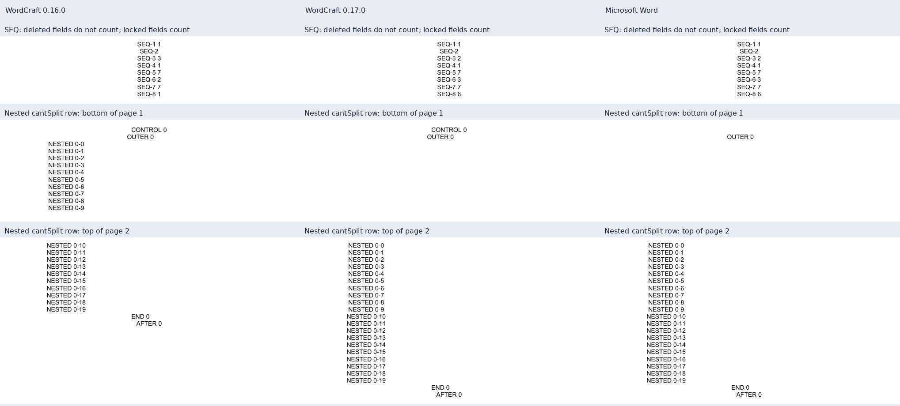

# Wordcraft 0.17.0: Word compatibility comparison

<!-- cspell:words PAGEREF STYLEREF PDFium pypdf cantSplit -->

## Version and comparison boundary

The opt-in renderer targets official stable CLI **0.17.0**, released on
9 November 2026 at 12:07:17 UTC, commit
`5574b32600aa7d782c64f5a6c6bb24696152220d`. The previous supported version is
0.16.0, commit `02a802cbafe45b5c8fecc00490c8f6b78c5ba251`.
The integration uses the official engine without a local fork.
The frozen generator base is `512e4de`; each paired measurement also records
the exact source DOCX hash.

The [0.17.0 release](https://github.com/storytold/wordcraft/releases/tag/v0.17.0)
body is cumulative from 0.15.1. The [official comparison](https://github.com/storytold/wordcraft/compare/v0.16.0...v0.17.0)
has divergent history and reports 329 ahead commits. This is not a count of
329 newly introduced fixes since 0.16.0. Comparing the actual production blobs
at the two pinned commits determines which changes belong to this upgrade.
Release titles and pull-request descriptions alone do not establish new behavior.
Historical measurements remain in the [0.16.0 audit](2026-11-09-wordcraft-0160.md).

## Source changes and acceptance boundaries

| Change                                                                        | Exact upgrade scope                                                                                                 | Acceptance boundary                                                                                                           |
| ----------------------------------------------------------------------------- | ------------------------------------------------------------------------------------------------------------------- | ----------------------------------------------------------------------------------------------------------------------------- |
| [TOC gallery #5952](https://github.com/storytold/wordcraft/pull/5952)         | Recognizes Word TOC gallery containers during import                                                                | Direct raw field-span, save/reopen/update and prepared-copy checks determine whether the adapter's TOC repair is still needed |
| [Ordinary indices #5802](https://github.com/storytold/wordcraft/pull/5802)    | Uses a 0.65 size factor rounded to half points for ordinary superscript/subscript runs                              | This is ordinary text sizing; OMML indices and matrices need separate controls                                                |
| [Cell spacing #5450](https://github.com/storytold/wordcraft/pull/5450)        | Suppresses contextual after-spacing for the last Normal or undefined-style cell paragraph                           | Defined other styles, disabled contextual spacing and compatibility-14 `allowSpaceOfSameStyleInTable` remain separate cases   |
| [Nested rows #5456](https://github.com/storytold/wordcraft/pull/5456)         | Propagates nested `cantSplit` constraints                                                                           | Does not replace the adapter's safe-boundary checks or establish support for arbitrary nested table continuation              |
| [Continuous sections #5287](https://github.com/storytold/wordcraft/pull/5287) | Honors `pageBreakBefore` at a continuous-section boundary                                                           | Other section starts and paragraph break combinations remain separate cases                                                   |
| [SEQ output #5594](https://github.com/storytold/wordcraft/pull/5594)          | Changes counting around locked and deleted sequence fields during output preparation                                | Explicit update and output-only refresh must be distinguished; numeric REF parity is separate                                 |
| [Lowered pictures #5796](https://github.com/storytold/wordcraft/pull/5796)    | Changes line extent when lowering a picture past its height                                                         | Does not establish a fix for the 700-pt table-cell picture on a 648-pt body                                                   |
| [Wrapping #5437](https://github.com/storytold/wordcraft/pull/5437)            | Suppresses a break only at `.(` before punctuation rules                                                            | Other punctuation is unchanged; disabled word wrapping or Asian wrapping can restore the break                                |
| [Fallback fonts #5851](https://github.com/storytold/wordcraft/pull/5851)      | Selects the first installed family from a semicolon-separated LibreOffice font list, then applies name substitution | Availability, actual glyph selection and Word font metrics are distinct checks                                                |
| [PDF author privacy #5452](https://github.com/storytold/wordcraft/pull/5452)  | With `removePersonalInfo`, omits the document creator unless an explicit PDF author is supplied                     | Metadata inspection is separate from page rendering and DOCX preservation                                                     |

Pinned production evidence: [TOC import](https://github.com/storytold/wordcraft/blob/5574b32600aa7d782c64f5a6c6bb24696152220d/crates/docx/src/read/toc.rs#L62-L103),
[ordinary indices](https://github.com/storytold/wordcraft/blob/5574b32600aa7d782c64f5a6c6bb24696152220d/crates/doc/src/resolve.rs#L137-L150),
[cell spacing](https://github.com/storytold/wordcraft/blob/5574b32600aa7d782c64f5a6c6bb24696152220d/crates/layout/src/boxes.rs#L366-L377),
[nested rows](https://github.com/storytold/wordcraft/blob/5574b32600aa7d782c64f5a6c6bb24696152220d/crates/layout/src/table_flow.rs#L97-L151),
[continuous sections](https://github.com/storytold/wordcraft/blob/5574b32600aa7d782c64f5a6c6bb24696152220d/crates/layout/src/flow.rs#L825-L835),
[SEQ preparation](https://github.com/storytold/wordcraft/blob/5574b32600aa7d782c64f5a6c6bb24696152220d/crates/engine/src/cmd/references/fields.rs#L122-L162),
[lowered pictures](https://github.com/storytold/wordcraft/blob/5574b32600aa7d782c64f5a6c6bb24696152220d/crates/layout/src/para/paragraph.rs#L397-L407),
[wrapping](https://github.com/storytold/wordcraft/blob/5574b32600aa7d782c64f5a6c6bb24696152220d/crates/layout/src/para/paragraph.rs#L869-L874),
[fallback lists](https://github.com/storytold/wordcraft/blob/5574b32600aa7d782c64f5a6c6bb24696152220d/crates/fonts/src/word.rs#L573-L651)
and [PDF metadata](https://github.com/storytold/wordcraft/blob/5574b32600aa7d782c64f5a6c6bb24696152220d/crates/pdf/src/metadata.rs#L8-L17).

TOC normalization targets Word gallery containers with a TOC heading and a
separate trailing field end; a bare-range TOC stays unwrapped. Nested row handling
still permits an oversized inner row to split on a fresh page. Upstream also
records rare border, shading and hit-rectangle limitations with thick borders
or explicit bottom margins. These narrow fixes do not imply complete TOC or
nested-table fidelity.

Source changes and measured outcomes have separate boundaries. The six new
release controls supplement the previous thirty-six-input corpus; final results
below use the corrected frozen source hashes.

## Equations and matrices

The production implementations in `math/bx.rs`, `glyphs.rs`, `nodes.rs`,
`rows.rs`, `state.rs` and `structs.rs` have identical blobs between the pinned
0.16.0 and 0.17.0 commits. The top-level math module changes only test font setup;
the DOCX math reader and writer also have identical blobs. See the pinned
[matrix geometry](https://github.com/storytold/wordcraft/blob/5574b32600aa7d782c64f5a6c6bb24696152220d/crates/layout/src/math/structs.rs#L290-L334)
and [row spacing](https://github.com/storytold/wordcraft/blob/5574b32600aa7d782c64f5a6c6bb24696152220d/crates/layout/src/math/rows.rs#L6-L29). The ordinary superscript/subscript
change can indirectly alter text runs that host or surround math; unchanged math
modules do not prove every mixed paragraph remains identical. No new matrix
algorithm, MathLeading correction or general equation-spacing improvement is
established by this upgrade. OMML preservation is separate from Word geometry.

Fresh paired formula-layout, math-and-appendix and matrix exports are
byte-identical between 0.16.0 and 0.17.0. Their respective page counts are 4, 5
and 4 in both engines and accepted Word output. Text, page geometry and
rasterized pixels are unchanged between engines. This confirms unchanged
rendering of these frozen controls; it does not establish general Word parity.

## Fields and TOC preparation

The adapter explicitly updates fields on a staged copy and preserves the source
DOCX. The fresh direct raw probe still reports numbered entries outside the TOC
field span in 0.17.0, as in 0.16.0; prepared-copy checks pass. The TOC gallery
import change therefore does not remove this adapter requirement. The existing
staging repair is retained. Field-span checks and source preservation are
separate from page-layout equality.

The fresh numeric REF control retains the relative `\r` discrepancy:
both engines return `1.1(a)` where Word returns `(a)`. Current-level `\n`
and full-context `\w` retain their Word-matching `(a)` and `1.1(a)` results.
The SEQ correction does not fix that independent REF switch.

## Measured release controls

The continuous-section control changes from one to two pages, matching Word's
two pages. The nested-table control changes from six to seven pages, also
matching Word. These two extra engine pages correct pagination; they are not
new pagination regressions.

In the nested positive control, the twenty inner paragraphs move from a 10/10
split across pages 1–2 to all twenty on page 2, as in Word. The negative control
retains its 10/10 split across pages 3–4. The oversized case still splits: its
old 10/50 distribution across pages 5–6 becomes 56/4 across pages 6–7, matching
Word. This measures the control's paragraph distribution, not complete nested
cell geometry.

The gap from the last `Beta` baseline to the following `AFTER` baseline changes
from 36 to 24 pt for contextual Normal and undefined-style cell paragraphs,
matching Word's 24 pt. Disabled contextual spacing, a defined other style and
missing contextual spacing remain at 36 pt; Word measures 36–36.03 pt.
Absolute positions still differ.

All twenty-two ordinary superscript/subscript spans, eleven pairs, now use the
nominal half-point sizes. Their maximum size difference from Word's exported
PDF falls from 0.24 to 0.06 pt. Baseline positions still differ; these are ordinary
text runs, not OMML scripts or a new equation-layout algorithm.

Eight picture controls use a 6-pt image lowered by 30 pt, with picture-only and
mixed-text variants. The new distances between surrounding marker baselines
are within 0.089 pt of Word. The exact-20-pt negative controls retain their line
box behavior. Marker-baseline distance is not image height; this does not
resolve oversized table-cell images.

The visible sequence results now match Word with both output-only refresh and
explicit update: `SEQ-3` changes 3 → 2, `SEQ-6` changes 2 → 3, and `SEQ-8` changes
1 → 6. Locked results retain 7; the deleted field's value remains hidden.
Raw saving preserves the source field caches, including the deleted cache 9,
and the original source bytes remain unchanged. Counting, visibility and cached
DOCX values are distinct observations.

The panel contains actual PDF crops of public controls. Columns show 0.16.0,
0.17.0 and Word, left to right. Rows show sequence counts, the nested `cantSplit`
control at the bottom of page 1, and its continuation at the top of page 2.
The page assignment improves to match Word; the panel does not establish full
geometric or visual identity.

## Frozen-corpus results

The final forty-two identical source inputs produce 291 pages in 0.16.0 and
293 in 0.17.0. Thirty-five paired PDFs are byte-identical and have unchanged
observed text, geometry and raster output. Seven PDFs change: the earlier
release control and the six new controls. All forty-two 0.17.0 PDFs are
byte-identical between Linux/WSL and native Windows, with 293 pages per platform.

Forty inputs have fresh accepted Word receipts: 200 Word pages versus 199 in
0.16.0 and 201 in 0.17.0. The two legacy inputs cover 92 engine pages and remain
outside fresh Word acceptance. The two corrected release fixtures use deleted
field instructions in `w:delInstrText` and unique IDs for eight `wp:docPr`
objects. Their initial invalid inputs and skipped Word attempts are excluded;
the final forty acceptances include fresh receipts for the corrected hashes.
Skips are not passes.

| Control                 | Word pages | 0.16.0 pages | 0.17.0 pages |
| ----------------------- | ---------: | -----------: | -----------: |
| Rebuilt coursework      |         69 |           68 |           68 |
| Rebuilt research report |         26 |           26 |           26 |
| Formula layout          |          4 |            4 |            4 |
| Math and appendix       |          5 |            5 |            5 |
| Matrix                  |          4 |            4 |            4 |
| Oversized picture       |          3 |            5 |            5 |
| Continuous section      |          2 |            1 |            2 |
| Nested table            |          7 |            6 |            7 |

The coursework, research report, formula, math-and-appendix, matrix,
oversized-picture and previous numeric-field PDFs are byte-identical between
engines. The coursework's missing page and oversized picture's two extra pages
remain. No formula or matrix improvement is established.

The 90-row table retains all rows with boundaries 1–28, 29–58, 59–88 and 89–90
on physical pages 6–9, plus three continuation captions in both engines,
native Windows and Word. The three-section control retains forty rows, two
continuation captions and page labels `1, 2, i, ii, 1, 2, 3`. The four large
inputs retain thirty-eight encoded image objects unchanged. They contain no
alpha masks, so mask preservation is not tested by this corpus.

### Font fallback integration boundary

Upstream's semicolon-separated fallback selection is a DOCX reader feature.
The generator's existing font preflight and local-file selection treat an
`rFonts` family value as a literal family; they do not explicitly resolve such
lists. This release does not add adapter support for that syntax. Its behavior
through this project's strict font mode remains untested. Use an explicit
verified family when strict preflight is required; engine fallback alone does
not prove the adapter verified each family alternative.

## Measurement method and platform boundary

Paired exports receive identical frozen DOCX bytes. Word comparisons use
accepted receipts for those exact sources with stable saved/reopened pagination
and verified cleanup. Independent PDF checks cover page count, normalized text,
geometry, resources and rasterized pixels; byte changes alone do not establish
layout changes. Page-wide raster means include white space, are not formatting
quality scores and can hide unmatched pages when page counts differ.

Word acceptance runs only through `npm run accept:word -- <docx>`.
Export success, PDF inspection, platform agreement and Word acceptance are
separate milestones. Native macOS rendering, other CPU architectures and a
physical Linux host remain untested. Upstream CI is not native rendering proof.
Native Windows execution records 799 successful CLI invocations and 1,598
owned process identities. Fresh process queries establish 1,597 identities
absent or exited. One parent query was denied; its completion is established
by its completed caller and the exact-child wait. All 1,598 identities are not
claimed freshly enumerated. No owned process needed termination, and staging
cleanup is recorded complete.

Separately, five public-gallery DOCX files received fresh native Word acceptance
with verified cleanup, totaling 29 pages. Fifteen formula-geometry cases pass
the fixture's regression tolerance. This is separate from the forty-two-input
Wordcraft comparison and does not establish STO compliance from a geometry
tolerance alone.

Private sources, extracted report text, licensed font files and operator paths
remain outside public Git. See the [compatibility matrix](../wordcraft-compatibility.md)
for the user-facing boundaries.
