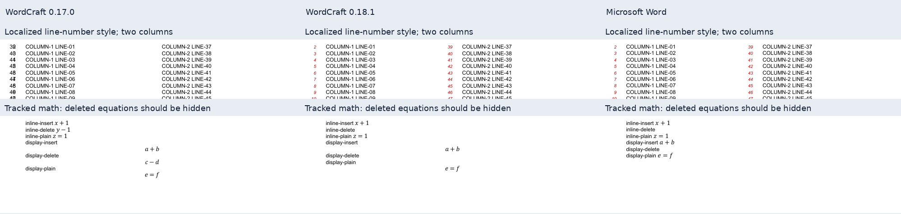

# Wordcraft 0.18.1: границы обновления

Проверяется официальный релиз [0.18.1](https://github.com/storytold/wordcraft/releases/tag/v0.18.1),
опубликованный 12 ноября 2026 года в 00:04:47 UTC. Тег указывает на коммит
`079f478bd85df7bcc567e3bafa7d7219096f9c3c`. Базовая версия интеграции –
0.17.0, коммит `5574b32600aa7d782c64f5a6c6bb24696152220d`.
Предыдущие результаты сохранены в [аудите 0.17.0](2026-11-09-wordcraft-0170.md).

Граница патча 0.18.1 – дерево 0.18.0, коммит
`7296cf64dec4ebdd210db4e12fa1b62debb5022f`. В сравнении этих деревьев изменены
семь файлов упаковки, CI и Flatpak; код отрисовки не менялся. Это утверждение
относится к патчу 0.18.0 → 0.18.1, а не ко всему переходу с 0.17.0.
Исправление разрешений обновления Flatpak описано в [PR 6339](https://github.com/storytold/wordcraft/pull/6339).

Использован официальный Linux CLI 0.18.1 без локальной ветки Rust; предыдущий
CLI 0.17.0 сохранён для сравнения. Обновление глобальной установки Windows здесь
не подтверждается. Нативный запуск на Mac не проверен; upstream CI не является
проверкой вёрстки на Mac.

Свежий контроль поля оглавления подтверждает необходимость подготовки: исходное
поле TOC напрямую не проходит проверку границ, подготовленная копия проходит.
Обход в интеграции сохраняется. Успешный экспорт не подтверждает полную
эквивалентность Word: формулы, таблицы, поля и итоговую пагинацию следует
проверять на целевом документе. Рекомендация уменьшить чрезмерно высокий рисунок
в ячейке до доступной высоты страницы относится к конкретной известной регрессии;
она не гарантирует исправление произвольных таблиц.

## Сравнение с 0.17.0

На наборе из 42 одинаковых DOCX все 42 PDF версий 0.17.0 и 0.18.1 побайтно
совпали: по 293 страницы в каждой версии. Это результат данного набора, а не
доказательство одинакового поведения на любом документе или совпадения с Word.

С четырьмя новыми контролями набор составляет 46 входов и 298 страниц в каждом
движке. На 46 из 46 входов PDF 0.18.1 побайтно совпали между Linux/WSL и
нативным Windows. Между версиями совпали 43 из 46 PDF: исходные 42 и контроль
открытого поля. Изменились контроль исправлений формул и два контроля нумерации
строк. Свежий Word-экспорт получен для 44 входов: 205 страниц Word против 206
в каждом движке; два старых входа на 92 страницы входят только в сравнение движков.
Четыре новых контроля занимают пять страниц и в Word, и в каждом движке.

В контролях с двумя колонками все процессы выводят одинаковую последовательность
из 73 номеров для 72 строк основного текста: дополнительные границы связаны
с разрывом колонки и завершающим абзацем. В 0.17.0 все номера стоят у левого
поля; в 0.18.1 и Word 37 стоят слева и 36 у второй колонки. Для локализованного
стиля 0.17.0 вывел Arial 10 чёрным, 0.18.1 – Arial Italic 8 красным `#C00000`,
Word – Arial Italic 8,04 красным. Разница положения новой версии с Word остаётся
примерно 0,26 пт по вертикали и 0,09 пт по горизонтали. В английском стиле
размер и цвет уже совпадали по выбранным признакам до обновления; изменилось
положение номеров второй колонки.

В контроле исправлений формул старая версия показывает удалённые `y-1` и `c-d`,
новая, как Word, их скрывает. Положение блочных формул всё ещё отличается от Word.

Слева – 0.17.0, в центре – 0.18.1, справа – Word. Показаны фрагменты публичных
контролей; сравнение всех строк и объектов выполнено отдельно. Совпадение
видимости удалённых формул не означает совпадение их расположения.

Контроли математики с приложением, матриц и раскладки формул побайтно не изменились
и занимают соответственно 5, 4 и 4 страницы в обоих движках и Word; это не доказывает
совпадение геометрии. Курсовая занимает 68 страниц в обоих движках и 69 в Word,
исследовательский отчёт – 26 во всех трёх процессах. Высокий рисунок в таблице
по-прежнему даёт пять страниц против трёх в Word, а относительный REF `\r` –
`1.1(a)` против `(a)` в Word.

В контроле таблицы на 90 строк совпали границы строк и три подписи продолжения;
в контроле трёх секций совпали метки 40 строк. Для 38 закодированных изображений
различий не обнаружено; масок в этом наборе нет. Эти результаты относятся только
к проверенным входам.

В переходе от 0.17.0 изменён код подготовки сетки секции перед измерением
колонтитулов; неизменность PDF указанного набора не доказывает неизменность
пагинации произвольных документов. Исправлено положение номеров строк относительно
текущей колонки. Геометрия математической раскладки не менялась; добавлены диапазоны
диагностики. Обработка исправлений математических объектов и строгий режим описаны
ниже.

Граница изменений проверена по точным деревьям тегов. Изменение порядка измерения
сетки секции относится к [PR 4683](https://github.com/storytold/wordcraft/pull/4683)
и [коду подготовки секции](https://github.com/storytold/wordcraft/blob/079f478bd85df7bcc567e3bafa7d7219096f9c3c/crates/layout/src/pass.rs#L273-L305).
Положение и локализованный стиль номеров строк исправлены в
[PR 6049](https://github.com/storytold/wordcraft/pull/6049).

Отдельные прямые проверки CLI выявили изменения при повторном сохранении DOCX
и обновлении полей:

- В контроле с шестью математическими объектами 0.17.0 сохранил формулы,
  но потерял все четыре обёртки исправлений. 0.18.1 сохранил четыре обёртки,
  включая тип, автора, дату и содержимое формул. В дополнительном защитном
  контроле с восемью объектами старая версия сохранила шесть, новая – все восемь
  и шесть обёрток. Этот второй контроль не подтверждён как допустимый документ
  приёмкой в Word.
- При прямом преобразовании с обновлением полей для защит `readOnly`, `forms`
  и `comments` старая версия завершилась с кодом 1 без файла; новая завершилась
  с предупреждением и записала DOCX, сохранив защиту и прежнее значение поля 104.
  В документе без защиты обе версии обновили это значение с 104 до 2. Успех
  команды при защите поэтому не доказывает, что поле обновлено: проверьте
  предупреждения и значение поля, а если обновление необходимо – снимите защиту
  разрешённым способом, обновите поле и проверьте результат.

Сохранение исправлений формул реализовано в [PR 6033](https://github.com/storytold/wordcraft/pull/6033):
[чтение](https://github.com/storytold/wordcraft/blob/079f478bd85df7bcc567e3bafa7d7219096f9c3c/crates/docx/src/read/story/runs.rs#L79-L116)
и [запись OMML](https://github.com/storytold/wordcraft/blob/079f478bd85df7bcc567e3bafa7d7219096f9c3c/crates/docx/src/write/story/object.rs#L51-L62).
Изменение прямого обновления защищённых полей относится к
[PR 5849](https://github.com/storytold/wordcraft/pull/5849). Наш путь через
`run` и `references.updateFields` по-прежнему явно завершается ошибкой при этих
трёх видах защиты; предупреждение с успешным сохранением относится к `convert --update-fields`.

## Граница строгого режима CLI

У upstream CLI строгий режим относится к `convert` и `render`, но не к `run`
или `script`. Это отдельная возможность от `--strict-fonts` нашего адаптера,
который проверяет доступность требуемых семейств шрифтов. В прямом контроле
повреждённого PNG строгий `convert` 0.18.1 завершился с кодом 3 без PDF и
выдал JSON с одним пропущенным изображением; обычное преобразование обеих версий
завершилось с кодом 0 и создало PDF. Проверка с символом U+0378 не вызвала
ошибку строгого режима, поэтому обнаружение отсутствующего глифа этим опытом
не подтверждено. Успешный экспорт сам по себе не гарантирует наличие всех
рисунков или символов; проверяйте итоговый PDF.

Возможность добавлена в [PR 6039](https://github.com/storytold/wordcraft/pull/6039).
Она не включена автоматически в сценарный экспорт нашего адаптера.

## Другие изменения upstream

[Релиз 0.18.0](https://github.com/storytold/wordcraft/releases/tag/v0.18.0) также
улучшает сохранение свойств ODT, разбор Unicode в RTF, положение первой строки
под колонтитулом при импорте старого DOC, региональные поля даты и времени,
сохранение содержимого колонтитулов при вставке номера страницы и работу интерфейса.
Эти маршруты не проверялись нашим сравнением сгенерированных DOCX с PDF и не
расширяют подтверждённую совместимость СТО.
