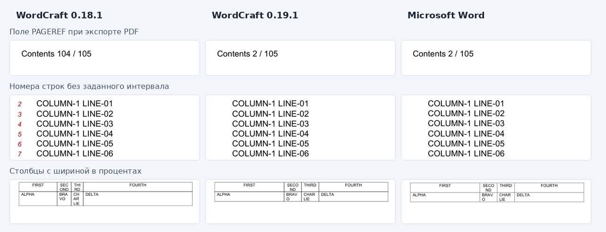

# Проверка WordCraft 0.19.1

<!-- cspell:words PAGEREF -->

Проверен официальный WordCraft 0.19.1, коммит `5d658dc033f3139926839bffd6ae0eef558c210c`.
Релиз опубликован 25 ноября 2026 года в 23:29 по Самаре. Предыдущая версия интеграции —
0.18.1, коммит `079f478bd85df7bcc567e3bafa7d7219096f9c3c`.
[Релиз](https://github.com/storytold/wordcraft/releases/tag/v0.19.1) ·
[Сравнение тегов](https://github.com/storytold/wordcraft/compare/v0.18.1...v0.19.1) ·
[Прошлый аудит](2026-11-12-wordcraft-0181.md)

Чтение и запись DOCX и RTF перенесены в `craft-libs`. В этом выпуске
WordCraft использует ревизию библиотеки `93dac78c93a7f1fd66e2022edeb089233b1dc45a`.
Библиотеке также передали обработку архивов и кодеков изображений.
Сборки Linux и Windows взяты из официального релиза и проверены по опубликованным SHA-256.
[Перенос DOCX и RTF](https://github.com/storytold/wordcraft/pull/6603) ·
[Архивы и кодеки](https://github.com/storytold/wordcraft/pull/6661) ·
[Зависимости релиза](https://github.com/storytold/wordcraft/blob/v0.19.1/Cargo.toml)

## Исправления на контрольных DOCX

- В PDF без явного обновления полей строка `Contents 104 / 105` стала
  `Contents 2 / 105`. Первая ссылка указывает на закладку на второй странице,
  вторая заблокирована. В обычной сборке генератора, где поля обновляются
  заранее, обе версии вывели `2 / 105`, как Word. Исходный DOCX сохранил
  прежние значения. В дополнительном контроле с римской нумерацией
  прямой экспорт 0.19.1 вывел `ii / 105`. После явного обновления поля
  тот же результат записали обе версии. [Исправление PAGEREF](https://github.com/storytold/wordcraft/pull/5129)
- В таблице с четырьмя столбцами первая строка задаёт доли 40/10/10/40 %,
  остальные ячейки имеют автоматическую ширину. 0.18.1 брал ширину из
  сохранённой сетки, поэтому узкие столбцы дробили слова. 0.19.1 учёл доли
  из первой строки. В варианте с центрированной шапкой максимальное
  расхождение координат границ с Word сократилось с 99,26 до 0,11 пт.
  [Расчёт ширины столбцов](https://github.com/storytold/wordcraft/pull/5074)
- В секции с `w:lnNumType` без `w:countBy` старая версия вывела 73 номера
  строк. Новая версия и Word оставили поля страницы без номеров.
  [Исправление нумерации строк](https://github.com/storytold/wordcraft/pull/6231)
- В контроле с исправлениями формул четыре обёртки вставки и удаления
  сохранились при повторной записи DOCX в обеих версиях. Удалённые формулы
  остались скрыты при экспорте PDF.

Верхний ряд показывает прямой вывод WordCraft и PDF из Word. Средний
показывает левую колонку из контроля нумерации. В нижнем ряду приведён
контроль с центрированной шапкой и видимыми границами.

## Сравнение на наших документах

Взяты 46 сценариев прошлого аудита и три новых контроля. Публичные
примеры и две текущие работы собраны из исходников на базе генератора
`f8f99c373426d8aae764fc59e878a52bf0e19b12`. Две архивные работы проверены
в готовом DOCX. Для каждой пары экспортов использовался один и тот же DOCX.
Во время сравнения проверены хеши входов, число страниц по содержимому PDF,
текст и совпадение растров страниц при 96 DPI. Для Word выполнена фоновая
приёмка в Word 16.0.20625 с повторным открытием, проверкой пагинации и завершения процессов.

Обе версии WordCraft дали по 306 страниц на 49 входах. При 96 DPI в 47
документах изображения всех страниц совпали. Изменились по одной странице
в контролях процентной ширины столбцов и нумерации строк. PDF новой версии
побайтно совпали между Linux CLI в WSL и нативным CLI Windows на всех 49 входах.

Для 46 входов с успешной приёмкой в Word получено 212 страниц Word
и по 213 страниц в обеих версиях WordCraft. Число страниц совпало
в 44 документах. Две архивные работы оставлены для сверки сборок
WordCraft. Контроль процентной ширины в исходном виде исключён
из сводки Word из-за выравнивания текста в шапке. Для него проведён
отдельный замер с центрированной шапкой.

| Сценарий                              | WordCraft 0.18.1 | WordCraft 0.19.1 | Microsoft Word |
| ------------------------------------- | ---------------: | ---------------: | -------------: |
| Курсовая, новая сборка                |               70 |               70 |             71 |
| Исследовательский отчёт, новая сборка |               27 |               27 |             27 |
| Формулы и приложение                  |                5 |                5 |              5 |
| Матрицы                               |                4 |                4 |              4 |
| Слишком высокий рисунок в таблице     |                5 |                5 |              3 |

Числа в таблице обозначают страницы. Одинаковое число страниц допускает
различия в формулах, таблицах и оглавлении. Обход подготовки оглавления
остаётся необходимым. В прямом вызове `references.updateFields` запись
«1.1 Математические формулы» не попала внутрь ожидаемого поля `TOC \f`
в обеих версиях. Обе версии прошли проверку на подготовленной копии.

Официальный универсальный CLI для macOS опубликован. Нативный экспорт
на Mac в этой проверке не выполнялся. Шрифты Windows, личные DOCX и их
страницы не входят в репозиторий.

## Диагностика изображений

Обе версии с `convert --strict` остановили экспорт контрольного DOCX
с повреждённым PNG. Код завершения — 3, файл PDF отсутствует, в JSON
указано одно пропущенное изображение. При обычном экспорте 0.19.1 тот же
файл дал PDF. Проверка семейств шрифтов через `--strict-fonts` действует
отдельно, а сценарный экспорт генератора работает без `convert --strict`.

## Другие изменения движка

При формировании оглавления, указателя и списка иллюстраций теперь
учитывается формат номера страницы целевой секции. Обновление оглавления
добавляет левую табуляцию для заголовков с номером и табуляцией, если
подходящей позиции не было. Исправлена обработка пустого предела у
сумм и других больших операторов при переводе уравнения в линейный текст.
Это отдельные изменения движка. Скорость длинных абзацев, ODT, RTF,
интерфейс и дополнительные варианты математических полей в нашем
сравнении отдельно не измерялись.
[Формат номеров](https://github.com/storytold/wordcraft/pull/5971) ·
[Отступ номера в оглавлении](https://github.com/storytold/wordcraft/pull/6738) ·
[Пустой предел](https://github.com/storytold/wordcraft/pull/6085) ·
[Раскладка длинного абзаца](https://github.com/storytold/wordcraft/pull/6759)
